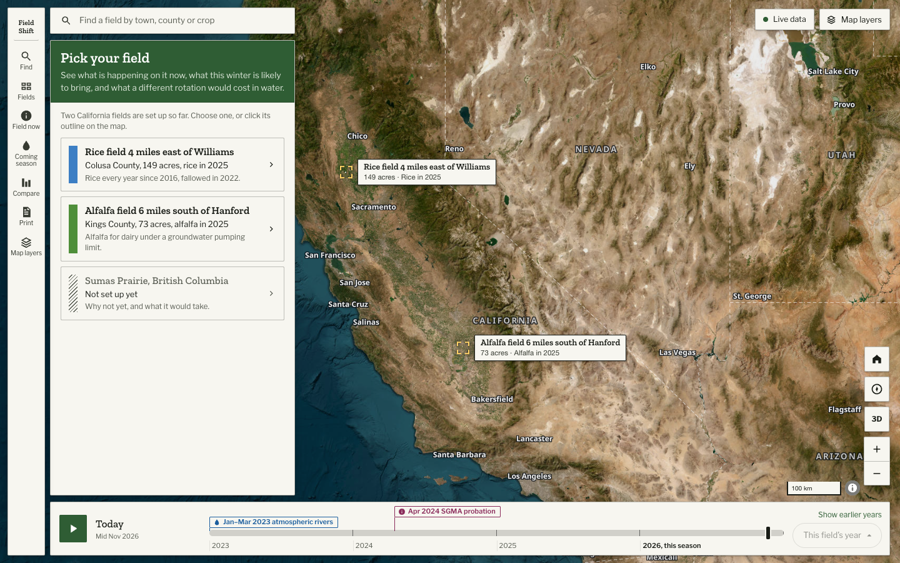

# CropLytics

**Plan next season's crop rotation with NASA data.**

[Live site](https://croplytics.xyz) · [Video](video/croplytics-30s-v9.mp4) · [Android app (APK)](https://github.com/spuriNV/space_apps/releases/latest/download/CropLytics-1.3.0.apk) · [Privacy](https://croplytics.xyz/privacy.html)

NASA Space Apps Challenge 2026 · Field Shift: Adapting Farms with NASA Data



## What it does

A grower and their adviser ask one question: what should this field grow next season? CropLytics answers it from satellite data.

- **Real field history.** Ten years of rain, soil moisture, groundwater and crop cover from NASA satellites, for the field you pick.
- **This week.** Water need, irrigation verdict and whether the field can be worked.
- **Compare rotations.** Each option shows what it gains and gives up in water, soil cover and risk, as likely ranges rather than single numbers.
- **A page for your adviser.** One printable brief per field.
- **Works anywhere in North America.** Tap any spot or draw a field. Indigenous lands show Nation tools and funding.
- **English and Spanish, fully accessible.**

## How to use it

### Website

Open [croplytics.xyz](https://croplytics.xyz).

1. **Pick a field.** Choose an example field, a pin from the farm catalog, tap anywhere on the map, or use **Draw a field** and tap its corners.
2. **Your field now.** See the season, rain, water need, greenness, soil and groundwater, plus this week's irrigation and field access.
3. **Coming season.** See winter rain, water supply and next season's need.
4. **Compare rotations.** See the best options with gain and give-up ranges. Set your water limit and re-score.
5. **Print for your adviser.** Print the one-page brief or save it as a PDF.

Tips:

- **Replay ten years** to watch the field change on the map.
- Turn on the **Rain & drought** layer to see wet and dry spells.
- Turn on the **Indigenous lands** layer to see reserves and tribal land with the tools and programs open to them.
- Use **Ask CropLytics** to ask a question by voice or in text.
- Open the **Accessibility** page at `#accessibility`. Use the language switch for English or Spanish.
- Deep links: `#example` (Colusa rice), `#example-bc` (Salmon River hay, BC), `#nations` (Nation tools).

### Android

Native app, version 1.3.0, for Android 8 and newer.

1. On your phone, open [**CropLytics-1.3.0.apk**](https://github.com/spuriNV/space_apps/releases/latest/download/CropLytics-1.3.0.apk) (or the [release page](https://github.com/spuriNV/space_apps/releases/tag/v1.3.0)).
2. Allow your browser to install unknown apps when Android asks.
3. Open CropLytics, pick a field, and swipe up on the sheet for the five steps.

### iOS

Native SwiftUI app with a MapLibre map, in [`apps/ios`](apps/ios).

1. On a Mac with Xcode 16 or newer: `brew install xcodegen && cd apps/ios && xcodegen generate`.
2. Open `CropLytics.xcodeproj`, choose an iPhone simulator or your own iPhone, and press Run.

## NASA data

| Dataset | What it answers |
| --- | --- |
| POWER | Daily weather and reference water use |
| GPM IMERG | How much rain fell |
| SMAP | How wet the soil is |
| GRACE-FO | How much groundwater there is |
| HLS Landsat and Sentinel-2 | What the field looked like, in 30 m cells |
| MODIS | Greenness and snow through the year |
| ECOSTRESS | Crop stress |
| OPERA DSWx | Where surface water stood |
| NASADEM | Elevation and slope |
| FIRMS, GIBS | Fires and daily imagery |
| ISS astronaut photography | A view of the area from orbit |

Partner data: ESA Sentinel-2. Also USDA, NOAA, ECCC, AAFC, California DWR and OpenET.

Our water estimate runs 16 to 21 percent above OpenET measurements, with nothing tuned.

## Run it locally

You need Node 20+ and [uv](https://docs.astral.sh/uv/). Cached data is committed, so no API keys are needed.

```sh
# Backend
cd backend/api && uv sync && uv run uvicorn app.main:app --port 8787

# Frontend (second terminal)
cd frontend/app && npm ci && npm run dev

# Android
cd apps/android && ./gradlew assembleDebug

# iOS (Xcode 16+; the generated project is committed)
brew install xcodegen && cd apps/ios && xcodegen generate
```

To use a local API with the frontend, see [`backend/api/README.md`](backend/api/README.md) for routes and options. Data checks for each backend folder are listed in its own README.

## Repo layout

| Folder | What |
| --- | --- |
| `frontend/app/` | The web app (Vite, React, TypeScript, MapLibre) |
| `apps/android/` | Native Android app ([README](apps/android/README.md)) |
| `apps/ios/` | Native iOS app ([README](apps/ios/README.md)) |
| `backend/api/` | FastAPI server and routes ([README](backend/api/README.md)) |
| `backend/engine/` | Crops, rotations and scoring with ranges |
| `backend/nasa/`, `backend/nasa_open/` | NASA data, with and without an Earthdata login |
| `backend/regional/`, `backend/field/`, `backend/ground/`, `backend/outlook/` | Weather, field outlines and crop history, ground data, seasonal outlooks |
| `backend/nation/` | Nation tools and funding programs |
| `schemas/`, `fixtures/` | JSON Schemas and example payloads |
| `data/cache/` | Cached source data per field |
| `design/` | Screenshots and design work |
| `video/` | The demo video |
| `docs/` | Plan, build spec, research |

More: [PLAN.md](PLAN.md), [CONTRACT.md](CONTRACT.md), [SIGNUPS.md](SIGNUPS.md), [docs/SUBMISSION.md](docs/SUBMISSION.md).

## Team

Caiden, Matthew, Saketh, Sri

CropLytics is an independent project. It is not endorsed by NASA or ESA.
